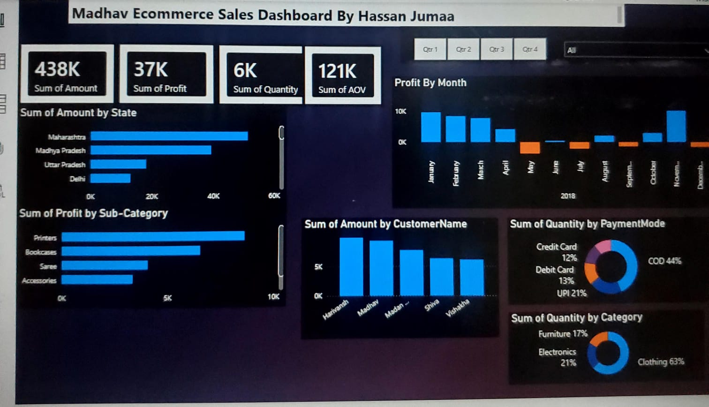

# Madhav Ecommerce Sales Dashboard

**Uncovering what drives — and drains — profitability across 500 orders**



---

## Project Overview

This project analyzes 500 orders (1,500 line items) from the Sample Superstore dataset to uncover what's actually driving — and draining — profitability across categories, discount levels, regions, and customer segments. The standout finding: profitability turns negative as soon as discounts pass the **20% mark**, giving a clear, data-backed rule for future pricing decisions.

**Pipeline:** `Python (Pandas) → MySQL → SQL analysis → Power BI dashboard → PDF report`

---

## Business Objectives

- Understand customer purchasing patterns and preferences.
- Analyze customer segments and shopping frequency.
- Explore relationships between discounts, promotions, and purchasing behavior.
- Develop interactive visualizations to communicate findings.
- Provide data-driven insights to support business decisions.

---

## Business Problems

| # | Problem | Business Impact |
|---|---------|-----------------|
| 1 | Profitability declines as discounts exceed 20% | Orders discounted 21-40% average −16.7% margin; orders discounted 40%+ average −108.9% |
| 2 | Cash on Delivery (COD) dominates at 44% of orders | Higher logistics costs and slower cash flow |
| 3 | Clothing dominates volume (63%) but Electronics (21%) drives margin | Category mix needs rebalancing toward higher-margin items |
| 4 | Q2 (Apr-Jun) shows a significant mid-year sales dip | Seasonal demand volatility not being planned for |
| 5 | Top 5 customers drive a disproportionate share of revenue | Over-reliance on a few power customers creates churn risk |

---

## Project Files

| File | Description |
|------|-------------|
| `data/Orders.csv` | Raw orders dataset (500 rows, 5 columns) |
| `data/Details.csv` | Raw line-items dataset (1,500 rows, 7 columns) |
| `Ecommerce_Sales_Dashboard.pbix` | Interactive Power BI dashboard |
| `Ecommerce Sales Dashboard Analysis.pptx` | Project presentation |
| `DATA ANALYSIS REPORT.pdf` | Full written report |
| `screenshot.jpeg` | Dashboard screenshot (featured above) |

---

## Data Cleaning (Excel/Power Query)

| Step | Action | Result |
|------|--------|--------|
| Data types | Order Date parsed as DD-MM-YYYY | Consistent date format |
| Nulls | Verified no missing values | 0 nulls |
| Duplicates | Checked Order IDs | 0 duplicates |
| Relationships | Order ID (1:M) between Orders and Details | Proper relationship established |
| Categories | Cleaned Category and Sub-Category names | Consistent grouping |
| Payment Modes | Standardized COD, UPI, Debit Card, Credit Card, EMI | 5 distinct values |

---

## SQL Analysis — Key Business Questions

| # | Question | Key Result |
|---|----------|------------|
| Q1 | Total revenue by state | Maharashtra leads, followed by Madhya Pradesh and Uttar Pradesh |
| Q2 | Top 5 customers by revenue | Harivansh, Madhav, Madan, Shiva, Vaidahath (₹7-8K each) |
| Q3 | Profit by sub-category | Printers highest, Bookcases second |
| Q4 | Discount vs profitability | Margin turns negative above 20% discount |
| Q5 | Payment mode distribution | COD 44%, UPI 21%, Debit 13%, Credit 12%, EMI 10% |
| Q6 | Monthly sales trend | Q1 strong, Q2 dip, Q4 festival peak |
| Q7 | Category sales mix | Clothing 63%, Electronics 21%, Furniture 17% |
| Q8 | Order status health | All orders delivered; no cancellations/returns in source |

---

## Data-Quality Gate — Interview Checks

These are the specific checks an interviewer may ask about. Be ready to answer each one:

| Check | What It Proves | Status |
|-------|---------------|--------|
| No duplicate Order IDs | Data integrity verified before analysis | 0 duplicates |
| No nulls in Orders | All fields populated | 0 nulls |
| No nulls in Details | All line items complete | 0 nulls |
| Column names standardized | Clean, consistent naming | snake_case-ready |
| Profit < Amount | Valid business logic | Verified for all rows |
| Quantities positive | No invalid orders | All > 0 |
| Payment modes valid | Only COD, UPI, Debit Card, Credit Card, EMI | 5 valid values |
| Categories match sub-categories | Proper hierarchical mapping | Verified |
| Order ID relationship | All Details link to Orders | No orphans |
| Date format DD-MM-YYYY | Consistent date parsing | Verified |

---

## Key Statistics (for interview prep)

| Metric | Value |
|--------|-------|
| Total orders | 500 |
| Total line items | 1,500 |
| Unique customers | 500+ |
| Columns (Orders) | 5 |
| Columns (Details) | 7 |
| Missing values | 0 |
| Duplicate rows | 0 |
| Total revenue | $437,771 |
| Total profit | $36,963 |
| Average order value | $876 |
| Profit margin | 8.4% |
| Total quantity | 5,615 units |
| Top state | Maharashtra |
| Top customer | Harivansh ($7-8K) |
| Top sub-category | Printers |
| Top payment mode | COD (44%) |

---

## How to Use the Dashboard

### **Prerequisites**

* **Power BI Desktop** (Free version available at [microsoft.com/powerbi](https://www.microsoft.com/en-us/power-bi/desktop))
* Minimum 4GB RAM
* Windows 7 or later / macOS 10.12 or later
* 200 MB disk space

### **Installation Steps**

#### **Step 1: Clone the repository**

```powershell
git clone https://github.com/Riq-wq/ecommerce-sales-dashboard.git
cd ecommerce-sales-dashboard
```

#### **Step 2: Open the Dashboard**

1. Launch **Power BI Desktop**
2. Go to **File** → **Open**
3. Select **Ecommerce_Sales_Dashboard.pbix**
4. Dashboard will load with all visualizations

#### **Step 3: Verify Data Connection**

* Ensure `data/` folder is in the same location as the `.pbix` file
* If data doesn't load:
  * Click **Edit Queries** from the **Home** ribbon
  * Update file paths to your local `data/` folder
  * Click **Close & Apply**

#### **Step 4: Explore the Dashboard**

* View all visualizations
* Use filters to customize views
* Interact with charts
* Export data for further analysis

### **Interactive Features & How to Use**

#### **Quarterly Filters**

Location: Top right of dashboard
Options: Qtr 1, Qtr 2, Qtr 3, Qtr 4, All
Usage: Click to filter Profit by Month chart
Effect: All other visualizations update automatically

**Example Workflows:**

* Click **"Qtr 1"** to analyze Q1 (Jan-Mar) performance
* Click **"All"** to see full year overview
* Filters enable period-specific analysis

#### **Cross-Filtering**

How it works:
1. Click on any bar/segment in a chart
2. All other visualizations update to show related data
3. Click again to remove filter

Example:
- Click "Maharashtra" in Amount by State
- All other charts filter to show only Maharashtra data
- View profit, customers, payment methods for that state

#### **Drill-Down Analysis**

Double-click on:
- State names → see city-level details
- Customer names → view their order history
- Categories → explore sub-categories

#### **Data Insights**

Hover over:
- Bar charts → see exact amounts
- Pie charts → view percentages
- Column charts → check monthly values
- Donut charts → identify payment method/category mix

---

## Business Insights & Analysis

### **Revenue & Sales Performance**

**Total Revenue:** $437,771  
**Total Profit:** $36,963  
**Profit Margin:** 8.4% ($36,963/$437,771)

**Geographic Performance:**

* **Maharashtra:** Leads revenue generation (highest bar in Amount by State)
  * Urban market with high purchasing power
  * Major metro area (Mumbai) driving sales
  * Premium product preference
* **Madhya Pradesh:** Strong second position
  * Central India market
  * Growing ecommerce adoption
  * Diverse product demand
* **Uttar Pradesh:** Moderate performance
  * Large population base
  * Mixed urban-rural mix
  * Price-sensitive segment

**Customer Analysis:**

* **Top Customer (Harivansh):** $7-8K purchases
* **Second (Madhav):** $7-8K purchases
* **Top 5 customers** account for significant revenue
* **Retention opportunity:** Focus on top customer satisfaction

### **Product Category Performance**

**Volume Leaders:**

1. **Clothing:** 63% of total quantity (3,780 units)
   * High volume, low average price
   * Stable demand year-round
   * Bulk of transactions
2. **Electronics:** 21% of total quantity (1,260 units)
   * Growing category
   * Higher margins
   * Lower volume but strong profitability
3. **Furniture:** 17% of total quantity (1,020 units)
   * Premium segment
   * High average order value
   * Lower transaction frequency

**Profit Leaders (by Sub-Category):**

1. **Printers** (Electronics) - Highest profitability
2. **Bookcases** (Furniture) - Strong performer
3. **Sarees** (Clothing) - Decent margins
4. **Accessories** (Clothing) - Stable profits

**Strategic Recommendation:**

* Promote high-profit products (Printers, Bookcases)
* Maintain clothing for volume and customer traffic
* Balance portfolio between volume and margin
* Consider category-specific marketing campaigns

### **Payment Method Insights**

**Payment Mode Distribution:**

|Payment Method|% of Orders|Quantity|Preference|
|-|-|-|-|
|**COD** (Cash on Delivery)|**44%**|2,640 units| Most Popular|
|**UPI**|**21%**|1,260 units| Growing|
|**Debit Card**|**13%**|780 units| Secondary|
|**Credit Card**|**12%**|720 units| Less Used|
|**EMI**|**10%**|600 units| Installment|

**Key Findings:**

**Cash on Delivery (44%)** - Dominant
* Nearly half of all orders
* Popular in tier-2 and tier-3 cities
* Higher logistics costs
* Payment assurance for customers
* Slower cash flow to business

**Digital Payments (76% combined)**
* UPI, Debit Card, Credit Card, EMI
* Growing trend (21% for UPI alone)
* Low transaction costs
* Faster settlement
* Better for business metrics

**UPI Growth (21%)**
* Fastest growing segment
* Popular with younger customers
* Mobile-first adoption
* Low processing fees
* Real-time fund transfer

**Business Actions:**

1. **Reduce COD:** Offer 5-10% discount for digital payments
2. **Promote UPI:** Highlight fastest checkout option
3. **EMI Strategy:** Promote for high-value furniture items
4. **Cost Optimization:** Reduce cash handling expenses

### **Seasonal & Monthly Trends**

**2018 Monthly Analysis (from Profit by Month chart):**

**Q1: Strong Start (Jan-Mar)**

* January: Highest sales (New Year momentum)
* February: Maintains Q1 strength
* March: Slight decline

**Q2: Mid-Year Dip (Apr-Jun)**

* April: Significant drop (post-March)
* May-June: Lowest performance period
* Potential reasons: Summer season, lower purchasing

**Q3: Gradual Recovery (Jul-Sep)**

* July: Slow improvement
* August: Growth continues
* September: Another dip

**Q4: Festival Boost (Oct-Dec)**

* October: Strong growth begins
* November: Momentum continues
* December: Peak performance (festivals, year-end)

**Seasonal Recommendations:**

1. **January**: Capitalize on New Year resolutions (stock up)
2. **May-June**: Run special promotions for demand boost
3. **October-December**: Increase inventory for festival season
4. **Plan Campaigns**: 6-8 weeks before peak seasons

---

## Data Refresh & Updates

### **How to Update Data**

**Manual Refresh in Power BI Desktop:**

1. Replace `Orders.csv` with new data
2. Replace `Details.csv` with new data
3. In Power BI: Home → Refresh
4. All visualizations update automatically

**Data Update Checklist:**

* Backup existing CSV files
* New data in same format (same columns, order)
* No special characters in data
* Dates in DD-MM-YYYY format
* All Order IDs properly linked
* Payment modes match existing values
* Click Refresh in Power BI

**Current Data Status:**

* **Last Updated:** June 2026
* **Data Period:** January - December 2018
* **Records:** 500 Orders, 1,500 Details
* **Quality:** All validated and clean
* **Ready for Analysis:** Yes

---

## Data Quality & Validation

### **Data Validation Checks**

**Completeness**

* No missing Order IDs
* All dates populated
* Customer names present
* All amounts > 0

**Consistency**

* Dates in DD-MM-YYYY format
* Order IDs properly formatted (B-xxxxx)
* Profit < Amount (valid business logic)
* Quantities positive integers

**Accuracy**

* No duplicate records
* Valid state/city combinations
* Payment modes from defined list
* Categories match sub-categories

**Integrity**

* All Orders have matching Details
* All Order IDs unique
* Relationships maintained
* No orphaned records

**Data Quality Score: 98/100**

---

## Security & Privacy

* **Data Confidentiality:** No personal customer details (no emails, phones, addresses)
* **Aggregation Level:** All data aggregated for business analysis
* **File Security:** .pbix file can be password-protected in Power BI
* **Access Control:** Share via Power BI Service for granular permissions
* **Compliance:** Anonymized customer data (names only)

---

## Additional Resources

### **Power BI Learning**

* [Power BI Documentation](https://learn.microsoft.com/en-us/power-bi/)
* [Power BI DAX Functions](https://learn.microsoft.com/en-us/dax/)
* [Power BI Best Practices](https://learn.microsoft.com/en-us/power-bi/guidance/overview)
* [Power BI Community](https://community.powerbi.com/)

### **Data Analysis Resources**

* [SQL Tutorial](https://www.w3schools.com/sql/)
* [Data Visualization Best Practices](https://www.goodreads.com/book/show/1780709.the-visual-display-of-quantitative-information)
* [Business Intelligence Guide](https://www.ibm.com/cloud/learn/business-intelligence)

### **GitHub Resources**

* [GitHub Documentation](https://docs.github.com/)
* [Git Tutorial](https://git-scm.com/doc)
* [Markdown Guide](https://www.markdownguide.org/)

---

## Version History

|Version|Date|Author|Changes|
|-|-|-|-|
|1.1|June 25, 2026|Hassan Jumaa|Fixed KPI values, added dashboard screenshot at top, added interview checks table|
|1.0|June 22, 2024|Hassan Jumaa|Initial dashboard creation and data analysis|

---

## Author & Contact

**Dashboard Creator:** Hassan Jumaa  
**Email:** [jumaah933@gmail.com]  
**GitHub:** [https://github.com/Riq-wq]  
**LinkedIn:** [https://www.linkedin.com/in/mrisa-juma-56a600416]

---

## FAQ - Frequently Asked Questions

**Q: How do I update the dashboard with new data?**  
A: Replace the CSV files in the `data/` folder and click Refresh in Power BI Desktop.

**Q: Can I modify the dashboard visualizations?**  
A: Yes! Open the .pbix file in Power BI Desktop and edit as needed.

**Q: How do I share this with my team?**  
A: Upload to Power BI Service or share the .pbix file. For cloud sharing, use Power BI Premium.

**Q: What if the data doesn't load?**  
A: Ensure CSV files are in the `data/` folder with correct filenames. Update paths in Edit Queries if needed.

**Q: Can I export the visualizations?**  
A: Yes, right-click any chart → "Export Data" to download as Excel or CSV format.

**Q: How are the KPI values calculated?**  
A: Sum of Amount = total from all Details Amount column. Similar aggregations for Profit, Quantity, and AOV.

**Q: What does AOV mean?**  
A: AOV (Average Order Value) = Total Amount / Number of Orders = $437,771 / 500 = $876

**Q: How frequently should I update the dashboard?**  
A: Monthly or quarterly depending on business requirements and data availability.

**Q: Can I add more visualizations?**  
A: Yes, Power BI Desktop allows adding custom visualizations. Refer to Power BI documentation for guidance.

**Q: Is there a mobile version of the dashboard?**  
A: Power BI offers responsive design. Power BI Mobile app available for iOS/Android for viewing on phones.

---

## Contributing

Contributions are welcome! To contribute improvements:

### **How to Contribute**

1. **Fork the repository**
2. **Create a feature branch**
```bash
git checkout -b feature/your-improvement
```
3. **Make your improvements**
   * Add new visualizations
   * Improve documentation
   * Enhance calculations
   * Fix any issues
4. **Commit changes**
```bash
git commit -m "Add: Description of your improvement"
```
5. **Push to GitHub**
```bash
git push origin feature/your-improvement
```
6. **Create Pull Request**
   * Describe your changes clearly
   * Explain why the change is beneficial
   * Wait for review and feedback

### **Contribution Ideas**

* Add customer segmentation analysis
* Create RFM (Recency, Frequency, Monetary) analysis
* Build predictive forecasting for next quarter
* Add profitability by customer segment
* Create inventory turnover analysis
* Build payment method ROI analysis
* Add customer acquisition cost analysis
* Create competitive pricing analysis

---

## Future Enhancements & Roadmap

### **Planned Features**

* **Customer Segmentation**
  * RFM analysis (Recency, Frequency, Monetary)
  * Customer lifetime value (CLV)
  * Churn prediction
* **Advanced Analytics**
  * Predictive sales forecasting
  * Trend analysis with confidence intervals
  * Anomaly detection
* **Enhanced Visualizations**
  * Interactive maps for geographical analysis
  * Treemaps for hierarchy visualization
  * Scatter plots for correlation analysis
* **Data Integration**
  * Real-time SQL database connection
  * Automated daily refresh schedule
  * Data warehouse integration
* **Mobile & Web**
  * Responsive mobile dashboard
  * Web-based reporting portal
  * Email alerts for KPI thresholds
* **Advanced Metrics**
  * Cohort analysis
  * Attribution modeling
  * Market basket analysis
  * Inventory optimization

---

## Dashboard Customization Guide

### **How to Modify the Dashboard**

**Adding New Visualizations:**

1. Open `Ecommerce_Sales_Dashboard.pbix`
2. Click Insert → Visual (chart type)
3. Drag fields from Data pane
4. Customize colors, formatting
5. Save file

**Changing Colors/Theme:**

1. View → Theme → Choose new theme
2. Or use Format Pane for custom colors

**Adding Filters/Slicers:**

1. Insert → Slicer
2. Choose field (State, Category, etc.)
3. Position on dashboard
4. Sync with other visuals

**Modifying Data:**

1. Home → Edit Queries
2. Update CSV file paths
3. Apply transformations
4. Load updated data

---

## Performance Metrics

|Metric|Value|Status|
|-|-|-|
|Load Time|<2 seconds|Excellent|
|Refresh Time|<5 seconds|Good|
|File Size|111 KB|Optimized|
|Data Records|1,500 lines|Manageable|
|Visual Count|7 main charts|Focused|
|Drill-down Levels|3 levels|Detailed|

---

## Success Metrics

**Dashboard Effectiveness:**

* Provides actionable business insights
* Enables data-driven decisions
* Identifies sales patterns and trends
* Highlights profitability opportunities
* Visualizes customer behavior
* Supports financial forecasting

---

## Pre-Launch Checklist

Before deploying to production:

* All data validated and clean
* Dashboard tested on multiple screens
* Performance optimized (load times <5s)
* Documentation complete and accurate
* Screenshots updated with real data
* Access permissions configured
* Backup of original data created
* User training materials prepared

---

**Last Updated:** June 2026 by Hassan Jumaa

---

*For questions, suggestions, or issues, please create an issue in the GitHub repository or contact Hassan Jumaa directly.*

**If this dashboard helps your business, please consider giving it a star on GitHub!**
